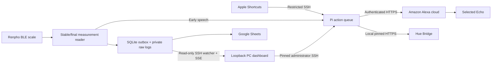

# Pi Homelab Bridge

**An iPhone notification bridge, a talking Bluetooth scale, local Hue controls,
and a small dashboard — built around a Raspberry Pi.**

Created and directed by **Felm ([@felmerm](https://github.com/felmerm))**, with
implementation assistance from OpenAI Codex. This is a working personal homelab
project being shared as an experimental reference, not a turnkey installer or
an official Amazon, Apple, Philips, or Renpho integration.

## What it does

- **iPhone → Echo:** Apple Shortcuts submits text through restricted SSH. The
  Pi validates and queues it, then sends a targeted Alexa announcement.
- **Scale → Echo:** a Renpho ES-CS20M produces Bluetooth measurements; the first
  stable weight triggers a randomized spoken response before Sheets logging.
- **Scale → Google Sheets:** final measurements enter a persistent SQLite
  outbox and upload with retry/deduplication. Private timestamped raw records
  stay on the Pi, including the decoded resistance field when available.
- **Local Hue:** validated light actions go straight to the paired Hue Bridge,
  using a certificate pin established during physical pairing.
- **Meme Scale editor:** response cards, good/bad groups, `{weight}` and
  `{audio}` placeholders, per-card no-audio, live validation, and explicit
  preview/save actions. Red = invalid, yellow = unsaved, green = saved.
- **Custom audio:** drag/drop or HTTPS-link MP3 import, conversion and local
  preview, then an explicit optional publication to your own public audio repo.
- **Dashboard and diagnostics:** service health, resources, weight history,
  live weight events without losing drafts, and lightweight outage logging.

Pi-hole can run alongside the project; this repository does not install it.
No Home Assistant or Voice Monkey relay is required.

## Architecture



Amazon receives speech text and public audio URLs. Google receives uploaded
measurements. The project runs locally, but these features require those cloud
services and internet access. Alexa control uses unofficial interfaces through
the pinned `aioamazondevices` library and may break when Amazon changes them.

## Start here

| Component | Entry points |
| --- | --- |
| Shared action API | [`notification-bridge/bridge.py`](notification-bridge/bridge.py), [`actions.py`](notification-bridge/actions.py), [API contract](notification-bridge/docs/ACTIONS.md) |
| Amazon session adapter | [`alexa_direct.py`](notification-bridge/alexa_direct.py), [`browser_link.py`](notification-bridge/browser_link.py) |
| Scale pipeline | [`renpho-scale/sheets_logger.py`](renpho-scale/sheets_logger.py), [`reactions.py`](renpho-scale/reactions.py) |
| Response cards and weight logs | [`dashboard/server.py`](dashboard/server.py), [`app.js`](dashboard/app.js), [`weight_logs.py`](dashboard/weight_logs.py) |
| Crash evidence | [`pi-diagnostics/`](pi-diagnostics/) |

See [setup](docs/SETUP.md), [security boundaries](SECURITY.md), and
[credits and upstream licenses](CREDITS.md).

## Example actions

These are JSON bodies for the authenticated `/actions` endpoint:

```json
{"action":"speak","message":"Hello from my Pi."}
```

```json
{"action":"audio","url":"https://your-host.example/sound.mp3","before":"Listen up.","after":"Okay then."}
```

```json
{"action":"mode","name":"meme","enabled":false}
```

Phone notifications use `announce`; scale responses use `speak` or `audio`.
The default special light scene is disabled. Alexa voice commands controlling
Pi actions and direct reminder creation are future work, not current features.

## Public examples and privacy

This repository is a curated source export. It contains **no Amazon session,
Google service-account key, bearer token, SSH/TLS private key, certificate,
phone profile, weight history, raw packet log, backup, or personal spreadsheet
destination**. Hostnames and device addresses in examples are placeholders.

The sample reaction catalog uses original demo text. Its audio compatibility
labels all point to the generated [demo tone](examples/tone.mp3); actual meme
recordings and personal cards are not bundled. Bring audio you have permission
to host, or choose **No audio**. Never publish personal recordings by accident.

## Tests

With Python 3.13, Node.js 22+, FFmpeg on PATH, and the component dependencies:

```sh
python -m unittest discover -s notification-bridge -p 'test_*.py'
python -m unittest discover -s renpho-scale -p 'test_*.py'
python -m unittest discover -s dashboard -p 'test_*.py'
python -m unittest discover -s pi-diagnostics -p 'test_*.py'
node --test dashboard/test_ui.cjs
```

Tests use synthetic data and mocked external services; they do not speak on a
real Echo, upload readings, or change lights. Live audible playback and hardware
behavior require separate checks. The public export also has a synthetic audio
fixture so conversion tests do not depend on private or third-party recordings.

## License

Custom source is [MIT licensed](LICENSE), copyright 2026 Felm. Dependencies and
their retained notices keep their own licenses. Attribution describes the actual
collaborative development process; third-party libraries remain their authors'
work.
